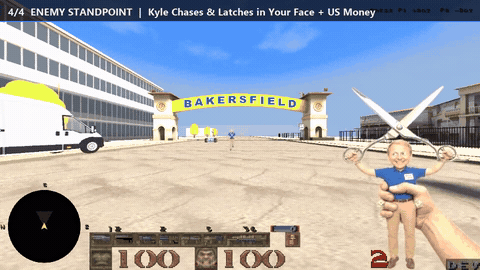
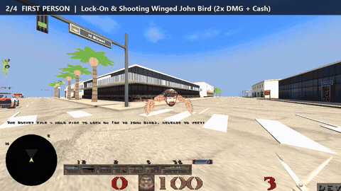
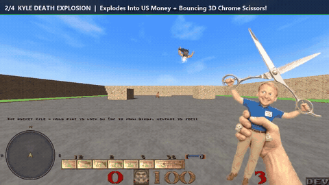
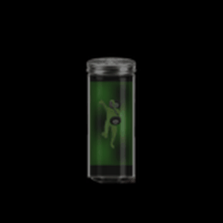
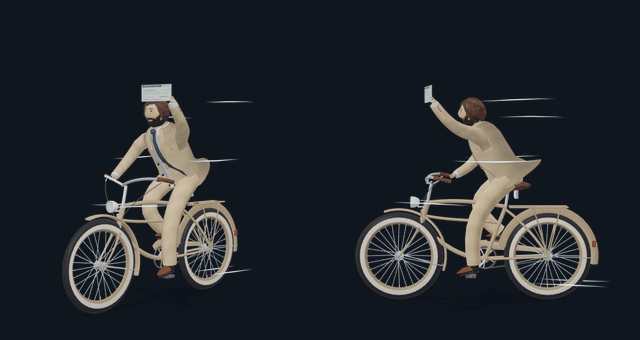

# BakersfieldQuake

**Bakersfield Quake is a retarded AI slop LAN party arcade game.**

Built on Quake, Combat+ (`quake15`), and the **Zircon Engine** (we no longer use DarkPlaces): unhinged AI-forged weapons (Pocket Kyle, Dookie Bazooka, Jar o' Green Guys, Wheelman Cannon, Pink Lady, Mega Man gun, NetSend, Mystery Box, jetpacks and more), Bakersfield maps (`bklan`, `orcom`, `fox`, and others), rideable vans and go-karts, and a chaotic LAN-party deathmatch ruleset.

## Certified AI Slop Gameplay

| Pocket Kyle sprints for your face | Normal Tuesday outside PG&E |
| :---: | :---: |
|  |  |
| *A tiny man with giant chrome scissors hunting you under the Bakersfield arch* | *Green wheel-man airborne on H Street while a winged mullet head approaches* |

| Explodes into US dollars & scissors | Jar o' Green Guys | Paycheck Rider |
| :---: | :---: | :---: |
|  |  |  |
| *Economic stimulus package* | *Shake well before throwing* | *Direct deposit acquired* |

## Play it

You need `pak0.pak` and `pak1.pak` from your own copy of Quake (Steam or GOG). They are not in the download because
they belong to id Software. On first run every launcher looks for them (Steam, GOG, the usual folders, then
`~/Downloads`) and copies them in.

Downloads are on the **Releases** page of this repo:

- **Windows:** `BAKOQUAKE.zip`. Unzip it and run `PLAY BAKERSFIELDQUAKE.exe`. It joins a LAN server if it finds one,
  otherwise it opens the intro. In game, F2 joins the LAN game; `Start Server.cmd` hosts one.
- **macOS (Apple Silicon, macOS 13+):** `BAKOQUAKE-macos-arm64.dmg`. Open it and drag BAKOQUAKE to Applications. It
  is signed and notarized, so it opens without a Gatekeeper warning. If it can't find your paks it asks for your
  Quake `id1` folder. Saved settings and the paks live in `~/Library/Application Support/BAKOQUAKE/`.
- **Linux:** `BAKOQUAKE-linux-x86_64.zip`. Needs system SDL2 (e.g. `sudo apt install libsdl2-2.0-0`). Unzip it and
  run `./Play.sh`; `./Start-Server.sh` hosts a LAN game.

On Windows and Linux the first launch adds shortcuts: a **BAKOQUAKE** Start Menu folder (game and server) plus a
Desktop shortcut on Windows, and `bakoquake.desktop`/`bakoquake-server.desktop` in `~/.local/share/applications`
plus a desktop copy on Linux (the server entry has a *Stop server* action). They point at wherever you unzipped the
game; if you move the folder, run it once from the new place and the shortcuts follow.

## Releases

Releases are built by the **Build release packages** workflow (`.github/workflows/build-zip.yml`, run by hand from
the Actions tab). It lays this repo's configs, launchers and generated overlay pk3s over the previous release's
data and publishes the Windows, Linux and macOS packages. Its `macos` job builds the macOS app with
`source/mac/build_app.sh`: Zircon and every library it loads are built from pinned sources, then the app and DMG
are signed, notarized and uploaded to the release. macOS packages are built and notarized only in CI, never by
hand. To test the app locally, `make app` builds it from this repo (signed, not notarized, no DMG) and launches it:
it overlays the repo's configs, tools and overlay pk3s and compiles `progs.dat`, `csprogs.dat` and `menu.dat` onto a base package
in `build/base`, downloaded once on a fresh checkout (`make base` refreshes it). `make run` relaunches it. The signing secrets are `MACOS_CERT_P12_BASE64`, `MACOS_CERT_PASSWORD`, `APPLE_ID`, `APPLE_TEAM_ID` and
`APPLE_APP_SPECIFIC_PASSWORD`.

## What is in this repo

Text and source only; the built game data is in the release download.

- `source/mm_tools/` - the QuakeC for the guns and game rules (`*.qc`), the Python that builds models, maps and sounds,
  and the per-feature notes.
- `source/mac/` - the macOS app: `build_app.sh` (used by CI) and `launcher.sh` (the app's main executable).
- `launchers/`, `tools/` - the Windows/Linux launchers and their helpers (pak finder, LAN scan).
- `website/` - the project web page.
- top-level `*.cfg`, `quake.rc` and `readme.txt`; design notes and plans in `docs/`, agent prompts in `docs/prompts/`.

## What is not in this repo

- Built data: `bakersfield.pk3`, `maps/`, `progs/`, `progs.dat`, `csprogs.dat` (about 1 GB; in the release zip).
- Quake's own data files (`id1/pak0.pak`, `pak1.pak`).
- The decompiled Combat+ game code (`source/qc_combat_decomp`). Combat+ belongs to its author, Totalitarian
  (https://www.moddb.com/mods/quake-combat), and is kept for personal use. The QuakeC here is meant to be patched into it
  by `source/mm_tools/patch_megaman_combat.py`.
- Personal settings (`config.cfg`, `personal.cfg`) and the large source art/video folders.

Keep this repository private: the release zip contains Combat+ and Quake 1.5 content that are not ours to redistribute.
