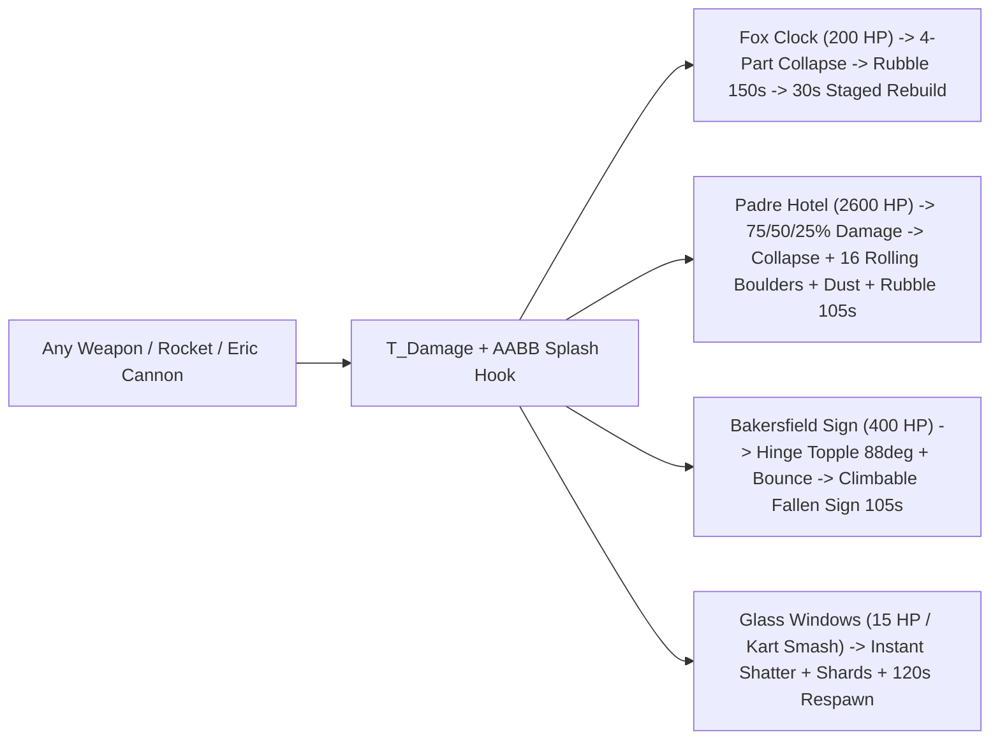

# Bakersfield-ish — Tech, Destructibles, Traversal & Delivery Feasibility Spec

**Phase 1 Technical Audit (`qc-tech-scout`)**  
**Workspace:** `G:\Quake\Combat\BakersfieldQuake`  
**Target Engine:** Zircon Engine (`G:\Quake\Combat\engine\zircon_beta_gcc.exe`)  
**Scope:** QuakeC / CSQC build pipeline, Zircon engine capabilities & limits, destructible landmarks architecture, universal weapon damage routing, traversal systems, video capture, offline 3D HTML viewer, and Telegram delivery readiness.

---

## 1. Executive Summary & Readiness Verdict

Every core system required for **Bakersfield-ish** is **feasible today** with zero engine changes and minimal, clean QuakeC additions (`bako_destruct.qc` + small hooks in `combat.qc`, `eric_cannon.qc`, `dn3_fx.qc`, `weapons.qc`, and custom dust entries in `effectinfo.txt`):

| Subsystem | Status | Proven In-Repo Precedent / Tooling |
|---|---|---|
| **Server QC (`progs.dat`)** | Ready | `D:\vibe\fteqw\2025-09-27-github\fteqcc64.exe` via `source/mm_tools/build_combat.py` |
| **Client CSQC (`csprogs.dat`)** | Ready (no changes strictly required) | `source/mm_tools/build_csqc.py` (stamps CRC `23147` from `csprogs_orig.dat`) |
| **Destructible Buildings + Rebuild** | Proven pattern | `source/qc_combat_decomp/spruce_tower.qc` + `origin`-brush submodels (`spruce_geom.py`) |
| **Shatterable Glass Windows** | Built-in | `source/qc_combat_decomp/breakable.qc` (`func_breakable`, `style 3` / `BTYPE_GLASS`) + `q15.pk3` assets |
| **Large Lingering Non-Blinding Dust & FX** | Ready | `effectinfo.txt` (`pointparticles`) + zero-server-edict CSQC `DN3FX_OnExplode` (`dn3_fx.qc`) |
| **Universal Weapon + Eric Cannon Damage** | Ready with 15-line AABB splash hook | `combat.qc` (`T_Damage`/`T_RadiusDamage`) + `eric_cannon.qc` (`EC_NukeBlastDamage`) |
| **Traversal (Go-Karts, Jetpacks, Jump/SkyPads)** | 100% Built-in | `misc_gokart_1..6` (`zz_karts.pk3`), `item_jetpack` (full CSQC HUD), `info_skypad`, `trigger_push` |
| **Cinematic Video Capture** | Ready | `build_showcase_video.py` + `vid1..vid6_director.qc` + `ffmpeg`/`ffprobe` installed |
| **Interactive 3D HTML Viewer** | Ready (adapt for offline `file://`) | `source/downtown/tools/export_bd_web.py` + `build_fox_showcase_html.py` single-file WebGL2 pattern |
| **Telegram + VPS Delivery** | Ready | `source/mm_tools/rocket_rider/deploy_video_telegram.py`, `curl`, `ssh`, Python `urllib.request` |

---

## 2. QuakeC / CSQC Build & Deployment Pipeline

### 2.1 Compilers & Scripts on This Machine
- **FTEQCC binary (verified present):** `D:\vibe\fteqw\2025-09-27-github\fteqcc64.exe`
  - *Note:* `source/qc_combat_decomp/build.bat` still points to the obsolete path `D:\vibe\quake1opensource\engines\win64\fteqcc64.exe` (missing on disk). Always use `build_combat.py` / `build_csqc.py` or invoke `D:\vibe\fteqw\2025-09-27-github\fteqcc64.exe` directly.
- **Server QC build (`progs.dat`, currently 3,436,298 bytes):**
  - Source directory: `source/qc_combat_decomp/` (`progs.src`, 234 lines).
  - Build command: `python -I source/mm_tools/build_combat.py`
  - **CRITICAL COPY/CLASH RULE in `build_combat.py`:** `build_combat.py` maintains a `COPY = (...)` tuple of legacy shared QC files it copies from `source/mm_tools/` into `source/qc_combat_decomp/` (prepending `#ifndef COMBATPLUS`) before compiling. If a `qc_combat_decomp` copy is newer than its `mm_tools` copy, `build_combat.py` aborts to prevent clobbering edits.
  - **Best practice for Bakersfield-ish:** Author all new destructible logic directly in `source/qc_combat_decomp/bako_destruct.qc` (and `bako_destruct_defs.qc` if needed), add them to `source/qc_combat_decomp/progs.src`, and do **not** put them in `build_combat.py`'s `COPY` tuple.
- **Client CSQC build (`csprogs.dat`, currently 614,950 bytes):**
  - Source directory: `source/qc_combat_decomp/csqc/` (`progs.src`).
  - Build command: `python -I source/mm_tools/build_csqc.py`
  - Compiles `csqc/progs.src`, stamps the original header CRC (`23147`) from `csprogs_orig.dat` into bytes `4..7`, and writes `BakersfieldQuake/csprogs.dat`.
  - **No CSQC edits are required** for Bakersfield-ish destructibles: existing `DN3FX` explosion/smoke relays (`ENT_DN3FX = 9`), `BM_DrawCenterPrint` corner toasts, and `JP_DrawHUD` jetpack fuel tank already work out of the box.
- **Packaging rule (`AGENTS.md`):**
  - Never modify `BakersfieldQuake/bakersfield.pk3` or `quake15/q15.pk3`.
  - Keep `progs.dat`, `csprogs.dat`, and `maps/bakersfieldish.bsp` + `.lit` as loose files.
  - Ship any new models/textures/sounds/shaders (e.g., Padre boulder MD3s, custom ruined/cracked textures, collapse SFX) inside a reproducible overlay PK3 `BakersfieldQuake/zz_bakersfieldish.pk3` generated by a deterministic Python builder (fixed `ZipInfo` timestamp `(1980, 1, 1, 0, 0, 0)`, sorted entries, `ZIP_STORED` for PNG/JPG/OGG, `ZIP_DEFLATED` for MD3/WAV/shader).

### 2.2 Existing Destructible & FX Systems in `source/qc_combat_decomp/`
1. **`spruce_tower.qc` (1,350 lines) — Direct Blueprint for Collapsing & Rebuilding Landmarks:**
   - Uses inline BSP submodels (`wt_part_legs`, `wt_part_catwalk`, `wt_part_tank`) built with `8×8×8` `"origin"` brushes (`source/mm_tools/spruce/spruce_geom.py:1114`) so `.angles = tilt` smoothly hinges the entire tower around its base!
   - Driven by a separate `MOVETYPE_NONE` controller entity (`misc_wt_controller`) thinking on `time` at `20 Hz` (`nextthink = time + 0.05`) — completely avoiding `MOVETYPE_PUSH`'s `.ltime` quirk.
   - Uses `Spruce_ShockShake` (`punchangle_x`/`punchangle_z`), `Veh_SpawnDebris` (`progs/veh_shrap1..4.md3`), `te_explosion`, `pointparticles`, `Spruce_NudgePlayersClear` (pushes players clear before re-solidifying rebuilt parts), and staged vertical growth (`setorigin` rising from underground over 22s) with optional comedic hard-hat worker NPCs (`npc_randguy/afroguy/fatguy.md3`).
2. **`breakable.qc` (1,781 lines) — Built-in Quake 1.5 / Arcane Dimensions Breakables:**
   - Provides `func_breakable`, `func_breakable_spawner`, `func_breakable_wall`.
   - `style 3` (`BTYPE_GLASS`) is fully wired to assets verified present in `quake15/q15.pk3`:
     - Sounds: `sound/break/glass_impact.wav`, `sound/break/glass_i1..4.wav`
     - Shard sub-BSPs: `maps/ad_brk/glass01..12.bsp` (plus `rock01..`, `brick01..17`, `wood01..`, `metal01..`)
     - Particle burst: `effect glass_break` in `effectinfo.txt` (40 sparkling blue-white bouncing glass flecks).
   - Also available in `bakersfield.pk3`: `progs/bklan/lan_deb_glass.md3` and `sound/lan/glass_tink.wav` (used by `lan_props.qc`), plus `progs/rubble1..3.mdl` in `q15.pk3` (`hiprubbl.qc`).
3. **`dn3_fx.qc` + `csqc/dn3fx_csqc.qc` — Zero-Server-Edict Sprite Explosions:**
   - `DN3FX_OnExplode(src, org, sc)` spawns a 0.14s transient `SendEntity` relay (`ENT_DN3FX = 9`) so CSQC locally renders capped animated 32-bit sprites (`dn3fx_explode.spr32`, `dn3fx_shockwave.spr32`, `dn3fx_fireball.spr32`, `dn3fx_smoke.spr32`, `dn3fx_flame.spr32`) with zero persistent server edicts.
4. **`vehicles.qc` (`Veh_SpawnDebris`, `Veh_WheelThink`) & `lan_props.qc` (`Lan_ThrowDebris`) — Capped Debris Pools:**
   - Demonstrates entity-capped `MOVETYPE_BOUNCE` + `SOLID_TRIGGER` debris pools that bounce cleanly off world BSP without ever snagging players, plus `Veh_WheelThink`'s ground-rolling orientation physics (ideal template for Padre Hotel's rolling street boulders!).

---

## 3. Zircon Engine Capabilities, Limits & Gotchas

Verified directly against `G:\Quake\Combat\engine\zircon_beta_gcc.exe`, `quake.rc`, `server.cfg`, `lowmem.cfg`, and `lowgpu.cfg`:

| Capability / Limit | Verified Behavior in Zircon | Design Implication for Bakersfield-ish |
|---|---|---|
| **BSP Format** | Supports `BSP2`, `BSP2RMQe`, `BSP29` | Compile with `BSP2` (unlimited clipnodes/faces/verts for merged downtown + 4 landmarks). |
| **Max Models (`MAX_MODELS`)** | **`8192`** (`MAX_MODELS_8192`) — shared across `*1..*N` inline brush submodels, MD3/MDL/SPR | Very generous. Keep inline destructible + glass submodels around **40–75 total** (`< 1%` of limit) to keep compile time, PVS updates, and network baseline tiny. |
| **Max Edicts (`MAX_EDICTS`)** | **`32768`** (`MAX_EDICTS_32768`) | Always cap dynamic debris/boulders (e.g., max 24 rolling boulders + 32 shrapnel) for network bandwidth and low-end CPU headroom. |
| **Rotating/Moving Brush Submodels** | `SOLID_BSP` + `MOVETYPE_PUSH` rotates smoothly around an `8×8×8` `"origin"` brush via `.angles` and translates via `setorigin()`. | **Use a `MOVETYPE_NONE` controller thinking on `time`** to animate `.origin`/`.angles` of falling submodels while `solid = SOLID_NOT`; switch `solid = SOLID_BSP` only for intact structures and resting climbable rubble mounds! Never let a giant rotating `SOLID_BSP` crush-pin players. |
| **Bouncing Debris Physics** | `MOVETYPE_BOUNCE` works reliably on point/bbox MD3/MDL entities (`SOLID_TRIGGER` or `SOLID_BBOX`), **NOT** on `SOLID_BSP` submodels. | Use **inline BSP submodels** for large hinged/pancaking architecture & climbable rubble piles; use **MD3 models (`MOVETYPE_BOUNCE`, `SOLID_TRIGGER`)** for tumbling boulders, bricks, clock gears, and glass shards. |
| **Gyro Gib Physics** | **`gyroset 0`** forced in both `quake.rc` and `server.cfg` (Gyro consumed 61% of server QC time with 15 bots). | Do **not** rely on Gyro for debris/boulders. Use native engine `MOVETYPE_BOUNCE` + lightweight `20 Hz` QC think. |
| **PVS Culling (`sv_cullentities_pvs 1`)** | Enabled in `server.cfg`. Moving/hidden bmodels stay visible only when their origin/bbox intersects player PVS. | Place each submodel's `"origin"` brush at its **visible street-level base/hinge** (not world `(0,0,0)`). When hiding inactive rubble/rebuilding parts underground, set `model = string_null` (and `solid = SOLID_NOT`) so they cost 0 network/draw overhead; restore via `setmodel(e, e.mdl)` + `setorigin()` when active. |
| **Baked Shadows on Collapsible Buildings** | Lightmapped `func_*` submodels cast static world shadows unless disabled. | Put `"_shadow" "0"` and `"_minlight" "48..68"` on all collapsible building submodels & rubble mounds so collapsing a skyscraper never leaves an ugly permanent pitch-black rectangle baked onto the street, and rubble mounds stay clearly lit when they rise! |
| **Low-Spec Configs (`lowmem.cfg` / `lowgpu.cfg`)** | `lowgpu.cfg` sets `cl_particles_quality 0.5` (particles stay ON at 50% density), `r_shadow_realtime_dlight 0`, `r_coronas 0`, `cl_decals_max 128`. `quake.rc` sets `sv_gameplayfix_setmodelrealbox 1`, `mod_freebeforeload 1`. | Never rely solely on dynamic lights for collapse readability; ensure dust/fireballs look great at `cl_particles_quality 0.5` by combining `effectinfo.txt` smoke clouds with CSQC `DN3FX` sprites (`dn3fx_explode.spr32` / `dn3fx_smoke.spr32`). |
| **Camera Shake & Zero-Blindness** | `punchangle` decays cleanly in engine (`v_kicktime`). `stuffcmd("bf\n")` and `v_cshift` wash the entire viewport. | **STRICTLY FORBIDDEN for collapses:** `bf`, `v_cshift`, `v_angle`/`fixangle` hijacking, or dark CSQC `drawfill` overlays. Use **bounded, distance-attenuated `punchangle` only** (Section 4.1). |

---

## 4. Core Technical Systems Design

### 4.1 Non-Blinding Earthquake / Collapse Camera Shake
To deliver visceral weight during collapses **without ever blinding, disorienting, or hijacking a player's aim**:

- **Respect existing cvar:** `if (!autocvar_effects_explosion_shake) return;`
- **Never emit:** `bf`, `v_cshift`, `fixangle`, `v_angle` overrides, or center-screen HUD boxes (per `CLAUDE.md` HUD rule, any status toast uses clean corner drop-shadowed text via `centerprint` / `BM_DrawCenterPrint`).
- **Clamped `punchangle` pulse helper (`Bako_SafeShake(vector org, float radius, float strength)`):**
  - Attenuates linearly with distance: `frac = bound(0, 1 - vlen(p.origin - org) / radius, 1)`.
  - Only affects `p.ishuman == 1` and `p.health > 0` (and halves roll if driving a vehicle so steering stays smooth).
  - Applies **hard-clamped** impulses (`strength` in `[0.3 .. 1.0]`):
    - Pitch (`punchangle_x`): `bound(-6.5, p.punchangle_x + crandom() * 4.8 * strength * frac, 6.5)`
    - Roll (`punchangle_z`): `bound(-4.5, p.punchangle_z + crandom() * 3.4 * strength * frac, 4.5)`
    - Yaw (`punchangle_y`): `bound(-2.5, p.punchangle_y + crandom() * 1.6 * strength * frac, 2.5)`
  - Fired in 6–10 decaying pulses (`0.18s` spacing) during the 2–4s collapse window: strong enough to feel like a skyscraper hitting pavement, gentle enough to track targets and keep fighting uninterrupted.

### 4.2 Large Lingering Non-Blinding Dust Clouds & Explosions
Modeled directly on `eric_nuke_mushroom` and `shambler_falling_dust` in `effectinfo.txt` (verified syntax), append 3 lightweight particle effects to `effectinfo.txt`:

1. **`bako_collapse_dust`** (rising/billowing concrete & stucco plume):
   - `type smoke`, `tex 0 7`, warm tan/stucco + concrete grey (`color 0x8e7c68 0xc8b69e` block + darker rubble core `0x4c443c 0x706458` block).
   - `size 68 112`, `sizeincrease 52`, **`alpha 80 130 15`** (fades slowly over **6–9 seconds**, and capped `< 130` so silhouettes remain readable even if you walk right into the cloud — zero white-out blindness!).
   - `time 6.5 9.5`, `originjitter 72 72 32`, `velocityoffset 0 0 95`, `velocityjitter 210 210 85`, `gravity -0.04`, `airfriction 1.35`.
2. **`bako_collapse_dust_surge`** (street-level rolling pyroclastic dust wave):
   - `type smoke`, `tex 0 7`, `color 0x9a8872 0xcbb9a2`, `size 58 96`, `sizeincrease 60`, `alpha 90 135 18`, `time 5.5 8.0`, `originjitter 84 84 18`, `velocityoffset 0 0 28`, `velocityjitter 340 340 36`, `gravity 0.06`, `airfriction 1.75`.
3. **`bako_rock_dust`** (trailing dust puff behind Padre's rolling street boulders):
   - `count 4`, `type smoke`, `tex 0 7`, `color 0x8a7a68 0xb4a28e`, `size 18 30`, `sizeincrease 22`, `alpha 75 115 48`, `time 1.6 2.4`, `velocityoffset 0 0 32`, `velocityjitter 48 48 20`, `airfriction 1.6`.
4. **Layered Collapse Explosions:**
   - Combine `DN3FX_OnExplode(ctrl, pt, 1.8..2.6)` (0 server edicts; renders animated 32-bit fireballs, shockwave rings, and rising smoke in CSQC) + `te_explosion(pt)` + `pointparticles(bako_fx_dust, pt, ...)` + `progs/s_explodbig.spr` for peak demolition beats.
   - Emit dust from 4–6 staggered footprint emitters every `0.35s` for `3.5s` during and right after impact so the cloud visibly hangs over the intersection for **~12–15 seconds** total with minimal network traffic.

### 4.3 Universal Weapon & Eric Cannon Damage Routing (Critical QuakeC Audit Findings)

Auditing `combat.qc`, `weapons.qc`, `eric_cannon.qc`, `wcannon.qc`, and all 20 custom weapon/vehicle QC files revealed **three critical QuakeC gotchas** that would otherwise break destructible buildings if ignored:

1. **Gotcha #1 — AABB-Center Distance Breaks Splash & Eric Cannon on Big Buildings:**
   - Both `combat.qc:T_RadiusDamage` (line 483) and `eric_cannon.qc:EC_NukeBlastDamage` (line 675) compute splash distance to `org = head.origin + (head.mins + head.maxs) * 0.5`.
   - For a `~600×500×700u` building like Padre Hotel, its center is **300–400u inside the walls**. A rocket (`160u` splash radius) hitting the sidewalk or an adjacent wing deals `0` splash damage, and **The Eric Deason Cannon** (`misc_eric_cannon`, which deals its 450 peak dmg / 750u tactical nuke ONLY via `EC_NukeBlastDamage`, never direct `T_Damage`!) loses >50% damage or misses completely!
   - **Solution (Clean 15-line AABB Splash Hook):** Maintain a linked list `bako_dest_head` of active destructible hit-targets (~8–15 entities max). Add `BakoDestruct_RadiusSplash(vector org, float radius, float peak_dmg, entity inflictor, entity attacker, entity ignore)` which clamps `org` to each target's `[absmin, absmax]` to compute exact **surface distance**, deduplicates against direct hits using `(e.bako_last_infl == inflictor && e.bako_last_infl_t == time)`, and calls `BakoDestruct_TakeDamage(...)`. Invoke it once at the end of:
     - `combat.qc:T_RadiusDamage` (covers Rockets, Grenades, Mega Man Buster, Wheelman Cannon `wcannon.qc`, Dookie, Banana, Pickle, Milky, Winged John bombs, Rocket Rider, Mega Man Tank, Go-Kart rockets)
     - `eric_cannon.qc:EC_NukeBlastDamage` (covers **The Eric Deason Cannon** ICBM nuke — with an optional structural multiplier, e.g. `1.5×–2.0×`, so 1 ICBM obliterates Bakersfield Sign / Fox Clock and chunks ~30–35% of Padre Hotel's massive HP!)
2. **Gotcha #2 — `DAMAGE_AIM` vs `DAMAGE_YES`:**
   - Stock `breakable.qc` sets `takedamage = DAMAGE_YES`, which causes grenades (`weapons.qc:3113`, `3364`: `if (other.takedamage == DAMAGE_AIM)`) to bounce off instead of exploding on direct hit!
   - **Solution:** Set **`takedamage = DAMAGE_AIM`** on all destructible buildings, Fox Clock, Bakersfield Sign, and shatterable glass. Every direct weapon (Shotgun, SSG, DN3 Shotgun, M4A1, M1 Garand, Sniper, Nailgun, SNG, Lightning Gun, Hammer, Axe, Chainsaw, Rockets, Grenades, Kyle, NetSend, Rob Dob, Wheelman Cannon, Eric Cannon, Tank, Go-Kart rockets) will then register cleanly on impact!
3. **Gotcha #3 — Suppress Blood & Flesh Sounds on Masonry/Metal/Glass:**
   - `weapons.qc:1303` (`TraceAttack`) already treats `SOLID_BSP` as gunshot sparks (no blood).
   - Add one entity flag `.float bako_material;` (`1=masonry`, `2=metal`, `3=glass`) and skip blood/flesh FX in `dn3_fx.qc:DN3FX_OnBlood` (`if (targ.bako_material) return;`) and `weapons.qc` chainsaw/melee blood checks, playing material-appropriate sparks + stone/metal/glass impact sounds instead.

### 4.4 Climbable Debris Piles & Safe Player Lifting
- **Geometry:** Pre-build sculpted, rampable debris mound brush entities (`bako_rubble_fox`, `bako_rubble_padre`, `bako_rubble_sign`) directly inside the `.map` with walkable slopes (`<= 38°` or `<= 18u` step ledges) so players and go-karts can climb straight onto the ruins and fight from the elevated rubble!
- **Activation without ever trapping a player:**
  1. At map start: tuck underground (`pos1 - '0 0 512'`), `solid = SOLID_NOT`, `model = string_null`.
  2. When collapse slams down inside the dust cloud: restore `setmodel(r, r.mdl)`, sweep smoothly upward over `0.6s` to `r.pos1`.
  3. Run `Bako_LiftPlayersOnto(r)`: for every player/vehicle/bot whose XY bounds overlap `r.absmin..r.absmax`, `traceline` straight down from `r.absmax_z + 64` onto `r` (after setting `r.solid = SOLID_BSP`) and lift them gently to `trace_endpos_z + 26` with a small upward hop (`velocity_z = max(velocity_z, 140)`). Result: players standing in the rubble zone pop up *onto top of the debris pile* cleanly — zero stuck-in-solid bugs!
- **Persistence & Cleanup / Rebuild:**
  - Persist solid & climbable for **90–120 seconds** (controlled by cvars `bako_rubble_time 105`, `bako_fox_rebuild_delay 150`, `bako_auto_rebuild 1`).
  - Before rebuilding, lower the rubble mound smoothly back underground over `2.5s` with gentle dust puffs (`solid = SOLID_NOT`, then hide `model = string_null`), then raise intact building tiers sequentially while running `Bako_NudgePlayersClear` (from `spruce_tower.qc:158`) so players are nudged smoothly outward or lifted onto the rising roof!

### 4.5 Tumbling / Rolling Boulders That Bounce Players (Padre Hotel)
- **Entity setup (`bako_boulder`):**
  - Custom rocky/concrete chunk MD3 models (`progs/bako/boulder1..3.md3`, `scale 1.2..2.2`, visual radius `~20–36u`, capped at 18 active boulders).
  - `movetype = MOVETYPE_BOUNCE`, **`solid = SOLID_TRIGGER`** (crucial: bounces cleanly off world/BSP floors & walls AND fires `.touch` on players/vehicles/monsters **without ever snagging or freezing a player**!), `setsize(b, '-22 -22 -22', '22 22 22')`, `bouncefactor = 0.62`, `bouncestop = 0.05`, `gravity = 0.85`.
- **Launch & Rolling Behavior (`Bako_BoulderThink` at 20 Hz):**
  - Launched in 3 waves during Padre Hotel's collapse (`t = 0.8s, 1.7s, 2.7s`) with `380..820 u/s` radial outward speed and `260..600 u/s` upward arc so boulders shower across 18th St, H St, and toward the Parking Garage.
  - Once bouncing low along the street (`vlen(xy_vel) > 55`), preserve rolling momentum (`xy_vel *= 0.968` per tick), compute rolling spin axis perpendicular to travel (`avelocity` proportional to speed so the rock visibly tumbles forward down the road!), and puff `bako_rock_dust` every `0.14s`.
  - Life: `12–16s` (or fades out over `1.0s` once settled `< 25 u/s` for 3 seconds).
- **Bouncing Players (`Bako_BoulderTouch`):**
  - On touching a player/bot/monster (while `vlen(self.velocity) > 85` and `time >= other.bako_boulder_hit_t`):
    - Set `other.bako_boulder_hit_t = time + 0.45` (no multi-frame shred).
    - Compute launch vector: `dir = normalize(self.velocity_xy * 0.7 + (other.origin - self.origin)_xy * 0.3)`.
    - **Bounce player cleanly:** `other.velocity = other.velocity + dir * bound(340, spd * 0.85, 680) + '0 0 270'`; clear `FL_ONGROUND`; apply tiny clamped `punchangle` (`±3°`), heavy rock-thud sound (`zombie/z_hit.wav`), and light knock damage (`15 HP`, cvar-tunable `bako_boulder_dmg 15`).
    - Rebound the boulder slightly (`self.velocity = self.velocity * 0.75 + '0 0 110'`) for hilarious physical pinball feel!
  - On touching a driving go-kart/vehicle: imparts a snappy lateral bump impulse (`velocity += dir * 240 + '0 0 120'`) + metallic clang!

---

## 5. Recommended Simplest / Highest-Visual-Quality Architecture per Destructible

### 5.1 Historic Fox Theater — Shoot Clock -> Collapse -> Climbable Rubble -> Slow Rebuild
- **Submodels (5 BSP entities + 1 `MOVETYPE_NONE` controller):**
  1. `bako_fox_clock` — Iconic clock face / upper tower crown (`takedamage = DAMAGE_AIM`, **`200 HP`** — 1–2 rockets, 1 Eric Cannon hit, or focused rifle fire). Also accepts damage if player shoots the clock directly from the street or rooftops.
  2. `bako_fox_tower` — Main Spanish tower (`origin` brush at base hinge, `_shadow 0`).
  3. `bako_fox_marquee` — Front marquee + lobby facade (`origin` brush at base hinge, `_shadow 0`).
  4. `bako_fox_hall` — Main theater auditorium & stagehouse (`origin` brush at base center, `_shadow 0`).
  5. `bako_fox_rubble` — Sculpted climbable rubble mound with tilted broken marquee frame (`origin` brush at base, `_shadow 0`, starts hidden underground).
- **Sequence:**
  - **Clock Hit (0.0s):** Clock face explodes in sparks, glass shards, and bronze chime/boom; tower begins buckling.
  - **Collapse (0.0–3.2s):** Tower hinges forward (`angles_x` `0° -> 78°` with `u*u` gravity curve) into the street corner; marquee drops & pitches `0.4s` later; auditorium pancakes downward (`-260u`) with staggered `DN3FX_OnExplode` fireballs, `bako_collapse_dust` + `bako_collapse_dust_surge` clouds, and clamped `Bako_SafeShake`.
  - **Ruins (3.2s–153s / ~2.5 min):** Falling pieces hide underground as `bako_fox_rubble` rises inside the dust cloud, lifts any overlapping players cleanly onto the pile, and stays solid & climbable for combat.
  - **Slow Rebuild (~30s, modeled on `spruce_tower.qc`):** Rubble sinks gently (`2.5s`), then `hall -> marquee -> tower -> clock` rise smoothly tier-by-tier from the foundation with welding sparks (`te_spark`), metal clangs, optional comedic construction worker NPCs (`npc_randguy/afroguy/fatguy.md3`), `Bako_NudgePlayersClear` safety nudging, and a triumphant chime when Fox Theater stands restored!

### 5.2 The Padre Hotel — High-HP Siege -> Progressive Cracking -> Collapse + Bouncing Boulders + Huge Dust Cloud + Climbable Rubble
- **Submodels (4–5 BSP entities + 1 controller):**
  1. `bako_padre_lower` (Lobby + Floors 1–3, `origin` brush at base center)
  2. `bako_padre_mid` (Floors 4–6, `origin` brush at Floor 4 hinge)
  3. `bako_padre_upper` (Floors 7–8 + rooftop parapet & iconic roof sign, `origin` brush at Floor 7 hinge)
  4. `bako_padre_rubble` (Tall 2-story terraced, rampable debris mountain players can climb for high ground, starts hidden underground)
  - All 3 intact tiers forward damage to a **shared HP pool (`2600 HP`, cvar `bako_padre_hp`)**: requires ~22–26 direct rockets, ~3–4 Eric Cannon ICBM hits, or sustained fire from any mix of weapons!
- **Progressive Feedback Milestones:**
  - **75% HP (`1950`):** Cracking masonry thunder + dust puffs at hit spot + 2 small falling bricks.
  - **50% HP (`1300`):** Persistent smoke vents from mid-floor windows + subtle rumble + corner toast (`"PADRE HOTEL STRUCTURE CRACKING!"`).
  - **25% HP (`650`):** Heavy smoke + creaking steel + 3 early falling rock chunks (`"PADRE HOTEL ABOUT TO COLLAPSE!"`).
- **Collapse Sequence (4.2s):**
  - Climbing demolition bursts up all 8 floors (`DN3FX_OnExplode` + `s_explodbig.spr` + `vehicles/car_boom2.wav`).
  - `lower` pancakes straight down (`-320u`), `mid` tilts `14°` and drops (`-480u`), `upper` shears outward `26°` as it plunges (`-680u`).
  - **16 Rolling/Tumbling Boulders (`bako_boulder`):** Spawned in 3 radial bursts across 18th St, H St, and toward the Parking Garage, tumbling/rolling along the asphalt and bouncing players/karts they collide with!
  - **Massive Non-Blinding Dust Cloud:** 6 footprint emitters fire `bako_collapse_dust` + `bako_collapse_dust_surge` over 4s, billowing out into the streets for ~12–15s while keeping player visibility clean.
  - **Climbable Rubble Pile:** `bako_padre_rubble` rises into place inside the dust cloud, stays solid for `105s` (cvar `bako_rubble_time`), then optionally runs a 30s staged rebuild (`bako_auto_rebuild 1`) so it can be demolished again later in the match!

### 5.3 The Bakersfield Sign — Clean Hinge Topple + Bounce + Climbable Fallen Arch
- **Submodels (2 BSP entities + 1 controller):**
  1. `bako_sign_main` — Complete iconic arched Bakersfield Sign (`origin` brush centered right on the ground-level pivot line at the base of the pylons, `_shadow 0`, `takedamage = DAMAGE_AIM`, **`400 HP`** — ~3–4 rockets, 1 Eric Cannon hit, or concentrated gunfire).
  2. `bako_sign_fallen_clip` (or `bako_sign_rubble`) — Pre-built smooth rampable collision/rubble hull matching the fallen arch footprint (starts hidden underground; guarantees zero hull-snagging on thin rotated letters and lets go-karts **jump off the fallen sign like a ramp!**).
- **Sequence:**
  - **0.0s:** Base pylon explosions + bright neon electrical sparks (`te_spark`) + shattering glass bulbs (`glass_break` + `sound/break/glass_impact.wav`).
  - **0.0–1.6s:** `bako_sign_main` switches `solid = SOLID_NOT` and hinges smoothly `0° -> 88°` (`u*u` gravity curve) onto the street (knocking aside any player standing directly in its landing strip).
  - **1.6–2.0s:** Ground slam! Elastic rebound (`88° -> 81° -> 88°`), street dust surge (`bako_collapse_dust_surge`), clamped shake, and `bako_sign_fallen_clip` activates (`SOLID_BSP`, lifts players cleanly on top).
  - **After `105s`:** Optional slow 10s crane-hoist/hinge back to `0°` with welding sparks so the sign can be knocked down again!

### 5.4 Shatterable Glass Windows (Storefronts, Lobbies, Landmarks)
- **Implementation:** Wrap/extend existing `breakable.qc` (`func_breakable`, `style 3` / `BTYPE_GLASS`) with a thin `bako_glass` entity (or direct flag on `func_breakable`):
  - Uses existing `q15.pk3` glass sounds (`break/glass_impact.wav`, `break/glass_i1..4.wav`), shards (`maps/ad_brk/glass01..12.bsp` + `progs/bklan/lan_deb_glass.md3`), and `effectinfo.txt` `glass_break` sparkle burst.
  - **Enhancements over stock `func_breakable`:**
    1. `takedamage = DAMAGE_AIM`, `health = 15`, `alpha = 0.42..0.55` (clean translucent glass panes).
    2. **Speed-Smash Touch:** Any player sprinting/rocket-jumping (`> 260 u/s`) OR any driving **go-kart / vehicle** touching the glass pane shatters straight through it!
    3. **AABB Splash Participation:** Nearby rockets, Eric Cannon blasts, and parent building collapses automatically blow out surrounding glass panes!
    4. **Timed Respawn (`wait = 120`):** Glass silently restores intact after 2 minutes (skipping if a player stands inside the frame).
  - **Budget:** Place ~25–45 strategic large storefront/lobby/tower window bays across Downtown, Fox Theater, Padre Lobby, Golden West, Great Castle, and Larry's Warehouse.

---

## 6. Traversal Systems Inventory & Creative Mobility Blueprint

### 6.1 Verified Mod Traversal Entities (Zero New QC Required!)

| System | Exact Map Entity Classname(s) | Required Key-Values & Setup | Assets / HUD Integration |
|---|---|---|---|
| **Go-Karts** | `misc_gokart_1` .. `misc_gokart_6`, or `misc_gokart` (with `"cnt" "1..6"`, auto-cycles if omitted) | `"origin" "X Y Z"` (ground level, snaps cleanly), `"angle" "<yaw>"`. Uses `H` (`impulse 86`) to enter/exit, `SPACE` hop/drift (3-tier Blue/Orange/Purple Mini-Turbo), `SHIFT` Nitro (1560 u/s), `M1` tap=horn / hold=kart rocket. | `BakersfieldQuake/zz_karts.pk3` (42.8 MB, already shipped; builder `source/mm_tools/build_gokart_pk3.py`). **Natively detects BOTH `trigger_push` and `info_skypad`!** |
| **Jetpacks** | `item_jetpack` (standalone), PLUS auto-spawns beside every `item_armor2` (yellow armor) | `"origin" "X Y Z"` (auto-drops to floor, respawns in 30s). Gives `autocvar_jp_fuel` (40s climb / 50s hover). Activate: double-tap `SPACE` in mid-air or press `J` (`impulse 71`). | `progs/jetpack.md3` + `effectinfo.txt` `jp_*` FX. **Full CSQC HUD glass fuel tank** (`BMST_JPFUEL = 66`, `BMST_JPMAX = 67`) drawn by `JP_DrawHUD` in all 4 HUD styles (`bm_hud.qc`, `hud_style_1..4.qc`). |
| **Regular Jump Pads** | `trigger_push` (brush entity, textured `trigger`) | `"angles" "pitch yaw 0"` (or `"angle" "-1"` straight up; converted by `SetMovedir`), `"speed" "<N>"`. **CRITICAL:** QC sets `velocity = speed * movedir * 10`! Use `"speed" "75"` for `750 u/s` launch, `"speed" "110"` for `1100 u/s` (default `1000` clamps to `sv_maxvelocity`). Pair with visible pad trim/ring brush. | `ambience/windfly.wav`. Works for players on foot AND go-karts (`gokart.qc:376`). |
| **Super Jump Pads & Chained SkyPads** | `info_skypad` (point entity, `skypad.qc`) | `"origin" "X Y floor_z+26"` (resting player center + 2u!), `"pos1" "DX DY DZ"` (exact landing player origin), `"height" "<apex_z>"` (default `2900` — keep `>= 256u` below skybox ceiling!), `"message" "<Dest Name>"`. | Auto-raises `sv_maxvelocity 6500` on server & client; spawns 5 glowing visuals (`turrbase.mdl`, `ltg_aura.md3`, `aura.md3`, `laser.md3`, `s_dotmed_yell.spr` corona); grants 10s fall safety + anti-camp landing shockwave; launches **players, go-karts, Winged John, Rocket Rider, AND projectiles** (even Eric Cannon ICBMs!). |

### 6.2 How to Build Chained Cross-Map "Super Jump Pads"
- `info_skypad` enforces a `0.65s` re-trigger cooldown (`skypad_cool_t` / `gk_pad_cool`). Because any medium-to-long parabolic arc takes `1.5s–3.5s` of airtime, **chaining works natively with zero QC changes**:
  - Set **Pad A**'s `"pos1"` to **Pad B**'s `"origin"` (exact landing origin inside Pad B's `80×80×62u` trigger box), and **Pad B**'s `"pos1"` to **Pad C**'s `"origin"`!
  - Players or go-karts stepping onto Pad A automatically rocket across the skyline onto Pad B's roof/balcony and immediately catapult onward to Pad C (players can air-strafe or ignite their jetpack mid-chain to peel off at any intermediate landmark!).
- **High Skybox Requirement:** Because `info_skypad` arcs, jetpacks, Winged John, Rocket Rider, and Eric Cannon ICBMs (`+2300u` climb!) all share the airspace, set the Bakersfield-ish skybox ceiling to **`Z = 3400..3800`** (with Super Jump Pad `height` values in `1200..2600`) so no arc ever clips `CONTENT_SKY`.

### 6.3 Additional Built-in Mod Traversal & Fun Ideas (Ready to Place!)
1. **Parking Garage Roof -> Padre Hotel Go-Kart Super Jump:** Place `misc_gokart_1..6` in the Parking Garage & H Street; put a `trigger_push` speed-boost strip on the garage top deck feeding into an `info_skypad` that launches karts straight over/onto Padre Hotel roof and Fox Theater!
2. **Eric Deason Cannon Monuments (`misc_eric_cannon`):** Place 1–2 street pedestals (e.g., H St plaza & Golden West lot) so players can launch ICBM strikes directly into Padre Hotel, Fox Clock, or Bakersfield Sign!
3. **Aerial & Street Vehicles:** `misc_vehicle_van` (Bako Van), `misc_vehicle_gtcar`, `misc_vehicle_schoolbus`, `misc_vehicle_tuktuk`, `misc_vehicle_golfcart`, `misc_bike_bmx`, `misc_vehicle_johnbird` (Winged John), `misc_vehicle_rocketrider` (Paycheck Rocket Rider), `misc_mm_tank` (Mega Man Tank), `item_powerup_foreloco`.
4. **Autonomous Rideable Cruisers (`bk_cruiser` + `bk_route`):** A looping Pink Supercar (`cnt 1`) or elevated Podracer Sky-Chariot (`cnt 2`) cruising the perimeter avenue that players can jump onto and surf while firing rockets!
5. **Grappling Hook (`hook.qc`):** Already compiled in `progs.dat` (`hook.cfg` loaded in `quake.rc`) for rapid vertical climbs up Padre Hotel, Great Castle towers, and Fox Theater.
6. **Dynamic Rubble High-Ground:** When Padre Hotel or Fox Theater collapses, their climbable debris mounds open fresh vertical combat lanes and go-kart stunt ramps mid-match!

---

## 7. Video Capture, Offline Interactive 3D HTML Viewer & Telegram Delivery

### 7.1 Zircon Test Launch Rules (`CLAUDE.md` Mandatory Safety Checklist)
Every automated test, screenshot capture, or video recording MUST obey:
1. **Check no other `zircon_beta_gcc.exe` is running first:** `Get-Process zircon_beta_gcc -ErrorAction SilentlyContinue` (wait if user or another session is running one; when cleaning up, stop **only** your own launched PID).
2. **Never touch user `config.cfg`:** Always launch `G:\Quake\Combat\engine\zircon_beta_gcc.exe` (CWD `G:\Quake\Combat\engine`, `-basedir G:\Quake\Combat`) with an **isolated `-userdir <temp_dir>`** and **dedicated `-port 26098`** (or another unused test port).
3. **Scripted execution via `+defer`:** Never run a `wait` chain straight from the command line (blocks sign-on); use `+defer <sec> "exec <cfg>"`, end the cfg with `quit`, and capture logs via `-condebug +log_file zz_test.log` (never `condump`).

### 7.2 Deterministic Cinematic Video Capture Pipeline
Modeled directly on `source/mm_tools/build_showcase_video.py` and `source/mm_tools/vid1..vid6_director.qc`:
1. **Temp Director Compile (Production `progs.dat` stays untouched!):** Copy `source/qc_combat_decomp/*.qc` into `%TEMP%\bq_bakersfieldish_vid_build`, inject `bakersfieldish_director.qc` into `progs.src`, slim unused monster precaches, and compile `progs_showcase.dat` via `D:\vibe\fteqw\2025-09-27-github\fteqcc64.exe`.
2. **Pass 1 — Record Deterministic Demo (`showcase.dem`):** Launch isolated Zircon (`-window -width 1280 -height 720 -nosound -port 26098 +vid_mouse 0 +m_pitch 0 +m_yaw 0`) with `sv_progs progs_showcase.dat`, `sys_ticrate 0.02`, `cl_maxfps 30`, `record showcase bakersfieldish`. Script the director to fly through Downtown + all 4 merged landmarks, showcase Go-Karts / Jetpacks / Chained Super Jump Pads, smash glass, topple Bakersfield Sign, shoot Fox Clock -> collapse -> rebuild, and barrage Padre Hotel with rockets + Eric Cannon -> collapse + rolling boulders + dust cloud!
3. **Pass 1.5 — Stamp Smooth Demo Viewangles:** Run `stamp_demo_headers(dem)` (from `build_showcase_video.py:263`) to pack exact interpolated `(pitch, yaw, roll)` into every packet header, eliminating all camera jitter.
4. **Pass 2 — Lossless AVI + PCM Capture:** Launch isolated Zircon (with audio ON, `volume 0.85`, `cl_capturevideo_ogg 0`, `cl_capturevideo_fps 30`, `cl_capturevideo_demo_stop 1`, `cl_capturevideo 1`, `playdemo showcase`). Wait for `"Finishing capture of"` in log.
5. **Pass 3 — Telegram-Ready MP4 Encode & Visual Keyframe Audit:**
   - **Verified installed tools:** `ffmpeg.exe` & `ffprobe.exe` (`C:\Users\qxdc\AppData\Local\Microsoft\WinGet\Links\`), Python 3.12.10, `PIL` 13.0.0, `numpy` 2.5.4, `cv2` 5.0.0.
   - Encode with `libx264`, `-crf 23`, `-maxrate 8000k`, `-pix_fmt yuv420p`, `-c:a aac -b:a 160k`, `-movflags +faststart`, and smooth 2s fade-out, keeping final MP4 strictly **`< 49 MB`** (Telegram Bot API 50 MB cap). Extract keyframes across every act for visual verification before sending.

### 7.3 Offline Interactive 3D HTML Viewer Architecture
- **Audit finding on existing viewers:**
  - `source/downtown/tools/export_bd_web.py` + `bd_viewer_template.html` builds a superb Three.js WebGL2 walkthrough viewer (BSP2 geometry, `.lit` colored lightmaps, Hull-1 collision, Walk/Fly, SkyPads, MD3 vehicles/go-karts/Eric Cannon), **but uses `<script type="module">` + `fetch("map.json" / "map.bin")` + external `tex/*.png`**, which **fails under `file://` due to browser CORS** (requires HTTP server or VPS hosting).
  - `source/mm_tools/build_fox_showcase_html.py` proves the **100% offline single-file WebGL2** pattern (zero CDN, zero ES modules, zero `fetch()`, gzipped binary mesh arena + base64 JPEG/WebP textures).
- **Recommended Dual-Friendly Offline 3D HTML Viewer (`docs/bakersfieldish_3d_viewer.html`):**
  1. Reuse `export_bd_web.py`'s BSP2 + `.lit` + AssetFS (`bakersfield.pk3` + `zz_*.pk3`) geometry/lightmap extractor.
  2. Pack all mesh buffers (`map.bin`), lightmap atlas (`WebP`/`JPEG` data URIs), downscaled `256–512px` texture atlas, and skybox faces into **ONE self-contained HTML file** using a standard inline `<script>` (no `type="module"`, no `fetch()`) and browser-native `DecompressionStream("gzip")` + inlined lightweight WebGL2 renderer (or inlined non-module Three.js UMD).
  3. **Interactive Features Built In:**
     - **Works double-clicked offline via `file://`** in Chrome/Edge/Firefox with zero server and zero internet!
     - **Fly & Walk Modes** (WASD + Mouse-drag/PointerLock + touch controls + speed slider).
     - **Landmark Quick-Jump Camera Presets:** Padre Hotel, Fox Theater, Parking Garage, Golden West Casino, The Great Castle, Larry's Warehouse, Bakersfield Sign, Super Jump Pad Skyline Overview.
     - **Interactive Destructible Preview Toggle:** Because Fox Theater, Padre Hotel, Bakersfield Sign, and shatterable glass are distinct BSP submodels, include one-click UI buttons (**"Intact"** / **"Topple & Collapse"** / **"Ruined Rubble"**) that animate the exact hinge/collapse transforms and toggle the rubble mounds right inside the 3D browser viewer!
  4. *(Optional bonus)* Also publish the full multi-file `export_bd_web.py` bundle to VPS (`https://bakersfield.larrywew.fun/bakersfieldish/`) for sharing a direct link alongside the offline HTML file.

### 7.4 Telegram Delivery Tooling & Credential Audit
- **Verified tooling installed:**
  - Reference deployment pipeline: `source/mm_tools/rocket_rider/deploy_video_telegram.py` (uses Python stdlib `urllib.request` + optional `curl`/`ssh` — zero third-party packages required; note `requests` is not installed and not needed).
  - CLI utilities verified on PATH: `curl.exe` (`C:\WINDOWS\system32\curl.EXE`), `ssh.exe` (`C:\WINDOWS\System32\OpenSSH\ssh.EXE`), `ffmpeg.exe`, `ffprobe.exe`.
- **Verified configuration (no secrets exposed, no messages sent):**
  - Target BAKOQUAKE Telegram group chat ID in existing deploy scripts: `-4993867752`.
  - Existing VPS hosting target: `root@72.62.241.93:22` (`/var/www/megaman` -> `https://bakersfield.larrywew.fun/`, `/var/www/larrywew/bakersfield-quake` -> `https://larrywew.fun/bakersfield-quake/`).
  - **Bot token availability:** `TG_BOT_TOKEN` is not exported in the default shell environment, **however** bot token configuration already exists locally on disk in existing scripts on this machine, so Telegram delivery is **fully viable** once supplied at runtime via `TG_BOT_TOKEN` env var or `--token`.
  - **Mandatory secret hygiene:** Follow `deploy_video_telegram.py`'s strict standard — never hardcode any bot token in new scripts, logs, or docs; validate MP4 `ftyp` header + `< 49 MB` size + `<= 1024` UTF-16 char HTML caption; redact tokens from all stdout/stderr output.

---

## 8. Implementation Checklist for Phase 2+

1. **Map Authoring (coordinate with `downtown-auditor` & `landmarks-scout`):**
   - Set skybox ceiling `Z >= 3400` to give generous clearance for Super Jump Pads (`info_skypad`), Jetpacks, Winged John, Rocket Rider, and Eric Cannon ICBMs.
   - Author Fox Theater (`5` submodels + `origin` brushes), Padre Hotel (`4` submodels + `origin` brushes), Bakersfield Sign (`2` submodels + `origin` brush), and `25–45` glass window bays (`bako_glass` / `func_breakable`) with `"_shadow" "0"` and `"_minlight" "48..68"`.
   - Place `misc_gokart_1..6`, `item_jetpack`, `trigger_push` (remember `speed = desired_vel / 10`), chained `info_skypad` pairs (`origin_z = floor + 26`), and `1–2` `misc_eric_cannon` pedestals.
2. **Assets (`zz_bakersfieldish.pk3`):**
   - Generate 3 rocky/concrete tumbling boulder MD3s (`progs/bako/boulder1..3.md3`) + any new landmark/rubble textures via a deterministic Python builder.
3. **QuakeC (`source/qc_combat_decomp/bako_destruct.qc`) & `effectinfo.txt`:**
   - Implement `bako_destruct.qc` (Fox, Padre, Sign, Glass, Rolling Boulders, `Bako_SafeShake`, `Bako_LiftPlayersOnto`, `BakoDestruct_RadiusSplash`).
   - Add 3 tiny hooks (`combat.qc:T_RadiusDamage`, `eric_cannon.qc:EC_NukeBlastDamage`, `dn3_fx.qc:DN3FX_OnBlood` + `weapons.qc` blood skip).
   - Append `bako_collapse_dust`, `bako_collapse_dust_surge`, `bako_rock_dust` to `effectinfo.txt`.
   - Compile with `python -I source/mm_tools/build_combat.py`.
4. **Verification, Video, Offline 3D Viewer & Delivery:**
   - Verify all 4 destructibles + universal weapons (rockets, Eric Cannon, gunfire, kart smash) + traversal in isolated Zircon (`-userdir`, `-port 26098`).
   - Generate offline single-file `docs/bakersfieldish_3d_viewer.html` and deterministic `< 49 MB` showcase MP4, verify keyframes visually, and deploy to VPS + Telegram using `TG_BOT_TOKEN` at runtime.
